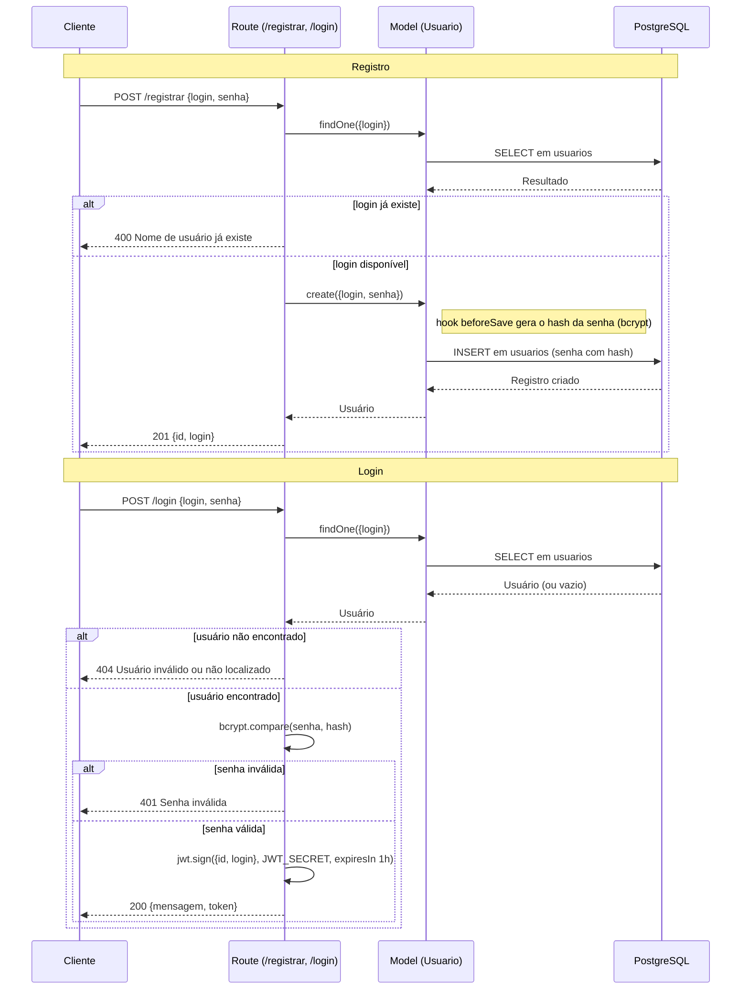
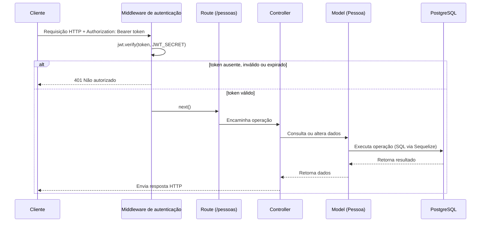

# API de Pessoas

Este projeto é uma API REST construída com Node.js e Express, com PostgreSQL configurado por meio do Sequelize, e autenticação via JWT. A organização em rotas, controllers e models separa a entrada das requisições, as regras da aplicação e o acesso aos dados.

## Responsabilidades das camadas

### Routes

A camada de rotas define os caminhos e métodos HTTP disponíveis e associa cada combinação a uma operação da aplicação. Por exemplo, `POST /pessoas` representa o cadastro de uma pessoa, enquanto `GET /pessoas/:id` representa a busca por uma pessoa específica.

As rotas devem tratar do direcionamento da requisição; a lógica de negócio e as consultas ao banco devem ficar nas camadas apropriadas.

### Controllers

Os controllers recebem a requisição encaminhada pela rota, acessam os dados enviados pelo cliente, chamam as operações necessárias e montam a resposta HTTP. Também são responsáveis por escolher o status adequado e encaminhar erros conforme o padrão adotado pela aplicação.

Assim, cada controller concentra o comportamento de uma operação, sem definir os caminhos HTTP nem implementar diretamente os detalhes de persistência.

### Models

Os models representam os dados da aplicação e sua estrutura no banco. Com Sequelize, um model define atributos e tipos de uma entidade — como uma pessoa — e permite executar operações de persistência, como criar, consultar, atualizar e remover registros.

Os models encapsulam o acesso aos dados para que controllers não precisem escrever consultas ou conhecer detalhes específicos do banco.

## Fluxo de uma requisição

As rotas de `/pessoas` são protegidas por JWT. Primeiro o cliente se registra (`POST /registrar`) e faz login (`POST /login`) para obter um token; depois envia esse token no cabeçalho `Authorization: Bearer <token>` em cada requisição. O middleware de autenticação valida o token antes de a requisição chegar ao controller. Os dados ficam em um banco PostgreSQL, acessado por meio do Sequelize.

### 1. Registro e login (obtenção do token)

### 2. Acesso a uma rota protegida (`/pessoas`)

## Estado atual

O projeto configura o Sequelize para usar PostgreSQL em `config/database.js`, com host, porta, nome, usuário e senha lidos do `.env` (instruções em `postgres_instruções.md`). Existem os models `Pessoa` e `Usuario` (a senha é salva com hash bcrypt) e as rotas `/registrar` e `/login`, que devolvem um JWT. O middleware `middleware/middlewareDeAutenticacao.js` ainda está vazio e não é importado em `app.js`, então a verificação do token descrita no diagrama 2 ainda precisa ser implementada. Há também um erro em `routes/autentica.js` (`env.process.JWT_SECRET` deveria ser `process.env.JWT_SECRET`).
