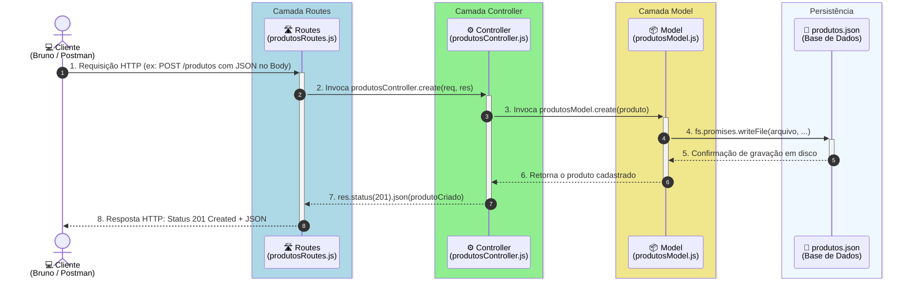

# Projeto de API REST de Produtos

Projeto desenvolvido para demonstrar a arquitetura em camadas **Model - Routes - Controller** em uma API REST com Node.js e Express, utilizando persistência em arquivo JSON (`produtos.json`).

---

## 🏛️ Arquitetura em Camadas (Model - Routes - Controller)

A aplicação segue o padrão de **Separação de Responsabilidades (*Separation of Concerns - SoC*)**, dividindo o fluxo da aplicação em três camadas principais: **Routes**, **Controller** e **Model**.

---

### 1. 🛣️ Camada Routes ([routes/produtosRoutes.js](file:///home/rpb/IFPI_26.2/Programação%20para%20Web%20II/ProgramacaoParaInternet_2_2026.2/Aula_2809_API_Produtos/routes/produtosRoutes.js))

#### 📌 Responsabilidades:
- **Porta de Entrada e Roteamento:** Expor e registrar os caminhos da API (ex.: `/produtos`, `/produtos/:id`).
- **Mapeamento de Verbos HTTP:** Associar cada método HTTP (`GET`, `POST`, `PUT`, `DELETE`) à respectiva função controladora.
- **Configuração de Middlewares Específicos:** Concentrar validações preliminares de transporte ou autenticação antes de passar o controle adiante.
- ❌ **O que NÃO faz:** Não executa regras de negócio, não valida consistência de dados e não acessa a base de dados.

#### 💡 Justificativa da Divisão (Por que isolar as Rotas?):
- **Centralização e Legibilidade dos Endpoints:** Permite que qualquer desenvolvedor veja de relance todos os endpoints e métodos suportados pela API em um único arquivo limpo e organizado.
- **Facilidade de Versionamento:** Caso a API evolua para prefixos como `/api/v1/produtos` ou `/api/v2/produtos`, basta reconfigurar o roteador sem impactar as regras de negócio já consolidadas.
- **Desacoplamento de Protocolo:** Protege o código de regras e dados de mudanças na estrutura de URLs.

---

### 2. ⚙️ Camada Controller ([controllers/produtosController.js](file:///home/rpb/IFPI_26.2/Programação%20para%20Web%20II/ProgramacaoParaInternet_2_2026.2/Aula_2809_API_Produtos/controllers/produtosController.js))

#### 📌 Responsabilidades:
- **Orquestração e Mediação:** Atuar como o cérebro/maestro que coordena o fluxo entre a requisição externa e a camada de dados.
- **Extração e Tratamento de Parâmetros:** Ler os dados recebidos via Express (`req.body` para payloads JSON, `req.params` para parâmetros de rota e `req.query` para filtros).
- **Regras de Negócio e Validações:** Garantir consistência e integridade das ações antes de acionar a persistência.
- **Coordenação Assíncrona:** Chamar os métodos assíncronos do Model com `await`.
- **Formatação de Resposta HTTP:** Definir os cabeçalhos, códigos de status HTTP semânticos (`200 OK`, `201 Created`, `204 No Content`, `400 Bad Request`, `404 Not Found`) e enviar a resposta estruturada via `res.status(...).json(...)`.
- ❌ **O que NÃO faz:** Não manipula arquivos em disco nem executa consultas diretas a banco de dados.

#### 💡 Justificativa da Divisão (Por que isolar o Controller?):
- **Proteção da Lógica de Negócio:** Impede que os objetos de requisição e resposta do framework (`req`, `res`) vazem para a camada de persistência.
- **Padronização das Respostas HTTP:** Centraliza em um único local a decisão de quais códigos de status e formatos JSON a API deve responder em cenários de sucesso ou falha.
- **Testabilidade:** Facilita a escrita de testes unitários que simulam requisições e respostas isoladas usando mocks do Model.

---

### 3. 📦 Camada Model ([models/produtosModel.js](file:///home/rpb/IFPI_26.2/Programação%20para%20Web%20II/ProgramacaoParaInternet_2_2026.2/Aula_2809_API_Produtos/models/produtosModel.js))

#### 📌 Responsabilidades:
- **Acesso e Persistência de Dados (DAO):** Gerenciar o armazenamento físico, leitura, filtragem, atualização e exclusão dos dados (CRUD).
- **Manipulação da Fonte de Dados:** Interagir diretamente com o mecanismo de armazenamento (atualmente o arquivo [`produtos.json`](file:///home/rpb/IFPI_26.2/Programação%20para%20Web%20II/ProgramacaoParaInternet_2_2026.2/Aula_2809_API_Produtos/models/produtos.json) através de `fs.promises`).
- **Garantia de Identidade dos Registros:** Controlar a geração de IDs únicos e integridade estrutural das entidades.
- **Independência de Protocolo:** Funciona puramente com objetos e arrays JavaScript e funções assíncronas (`async/await`).
- ❌ **O que NÃO faz:** Não conhece rotas, verbos HTTP, nem os objetos `req` ou `res`.

#### 💡 Justificativa da Divisão (Por que isolar o Model?):
- **Independência e Substituição de Banco de Dados:** É a maior vantagem desta arquitetura. Se amanhã o armazenamento mudar de um arquivo JSON para um banco relacional como **SQLite** ou **PostgreSQL** (ou NoSQL como MongoDB), **nenhuma linha do Controller ou das Routes precisará ser alterada**! Apenas o interior das funções do Model será adaptado para executar queries SQL (`SELECT`, `INSERT`, `UPDATE`, `DELETE`).
- **Reutilização fora do Contexto Web:** As funções do Model podem ser importadas e executadas por scripts CLI, tarefas agendadas (cron jobs) ou rotinas de teste sem a necessidade de um servidor web Express estar rodando.
- **Foco em Integridade dos Dados:** Concentra as operações críticas de leitura/gravação em um só lugar, evitando inconsistências causadas por múltiplos acessos concorrentes desordenados.

---

### 🎯 Por Que Dividir a Aplicação em Camadas? (Justificativa Arquitetural)

1. **Princípio da Responsabilidade Única (*Single Responsibility Principle - SRP*):** Cada arquivo tem apenas um motivo para ser alterado:
   - Mudou o endpoint ou verbo HTTP? Altera-se apenas **Routes**.
   - Mudou a validação, regra de cálculo ou código de status HTTP? Altera-se apenas **Controller**.
   - Mudou o banco de dados ou a forma de salvar? Altera-se apenas **Model**.
2. **Fim do Código Monolítico/Espaguete:** Evita concentrar centenas de linhas de código misturando roteamento, regra de negócio e persistência dentro de um único arquivo `app.js`.
3. **Manutenibilidade e Trabalho em Equipe:** Permite que desenvolvedores trabalhem em paralelo em diferentes camadas do sistema com menor risco de conflitos.

---

## 🔄 Diagrama de Sequência da Requisição

O diagrama abaixo demonstra o fluxo de uma requisição que chega ao servidor e como as camadas **Routes**, **Controller** e **Model** interagem entre si:

> **Representação dos Retângulos Verticais:**
>
> - **Caixas verticais de camada (`box`):** Destacam visualmente cada uma das camadas da arquitetura (**Camada Routes**, **Camada Controller**, **Camada Model** e **Persistência**).
> - **Retângulos verticais de ativação (barras de ativação UML):** Sobre a linha de vida de cada camada, indicam o tempo exato em que a camada está ativa processando a requisição.



---

## 🔍 Detalhamento do Fluxo Passo a Passo

| Etapa | Origem | Destino | O que acontece na camada |
| :---: | --- | --- | --- |
| **1** | **Cliente** | **Routes** | O cliente (navegador, Bruno, Postman) envia uma requisição HTTP. O Express recebe e direciona ao roteador da entidade (`produtosRoutes.js`). |
| **2** | **Routes** | **Controller** | A rota mapeia o método HTTP e rota correspondente, chamando a função controladora associada (ex: `produtosController.create`). |
| **3** | **Controller** | **Model** | O controller extrai os dados (`req.body` ou `req.params`), aplica a lógica necessária e invoca o método do model (`produtosModel.create`) usando `await`. |
| **4** | **Model** | **produtos.json** | O model realiza a leitura e persistência em disco utilizando operações assíncronas do Node.js (`fs.promises`). |
| **5** | **produtos.json** | **Model** | O arquivo confirma a escrita ou retorna o conteúdo JSON lido. |
| **6** | **Model** | **Controller** | O model devolve o produto ou lista de dados obtida para o controller. |
| **7** | **Controller** | **Routes** | O controller define o código de status HTTP (`res.status(201)`) e devolve os dados em JSON (`.json(produtoCriado)`). |
| **8** | **Routes** | **Cliente** | A resposta HTTP é concluída e devolvida ao cliente com o status e payload JSON final. |

---

## 📋 Mapeamento de Rotas e Camadas

| Verbo HTTP | Rota | Função na Camada Routes | Função na Camada Controller | Função na Camada Model | Descrição | Status HTTP |
| --- | --- | --- | --- | --- | --- | :---: |
| `POST` | `/produtos` | `router.post("/")` | `create(req, res)` | `create(produto)` | Cadastrar produto | `201 Created` |
| `GET` | `/produtos` | `router.get("/")` | `retreave(req, res)` | `retreave()` | Listar todos os produtos | `200 OK` |
| `GET` | `/produtos/:id` | `router.get("/:id")` | `read(req, res)` | `read(id)` | Buscar produto por ID | `200 OK` / `204 No Content` |
| `PUT` | `/produtos/:id` | `router.put("/:id")` | `update(req, res)` | `update(id, ...)` | Atualizar produto por ID | `200 OK` / `204 No Content` |
| `DELETE` | `/produtos/:id` | `router.delete("/:id")` | `remove(req, res)` | `remove(id)` | Excluir produto por ID | `200 OK` / `404 Not Found` |

---

## 🚀 Como Executar o Projeto

```bash
# Instalar as dependências
npm install

# Iniciar o servidor com auto-reload
npm run dev
```
