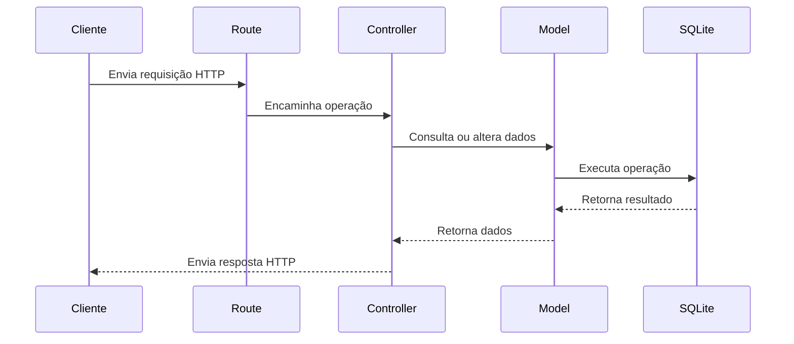

# API de Pessoas

Este projeto é uma API REST construída com Node.js e Express, com SQLite configurado por meio do Sequelize. A organização em rotas, controllers e models separa a entrada das requisições, as regras da aplicação e o acesso aos dados.

## Responsabilidades das camadas

### Routes

A camada de rotas define os caminhos e métodos HTTP disponíveis e associa cada combinação a uma operação da aplicação. Por exemplo, `POST /pessoas` representa o cadastro de uma pessoa, enquanto `GET /pessoas/:id` representa a busca por uma pessoa específica.

As rotas devem tratar do direcionamento da requisição; a lógica de negócio e as consultas ao banco devem ficar nas camadas apropriadas.

### Controllers

Os controllers recebem a requisição encaminhada pela rota, acessam os dados enviados pelo cliente, chamam as operações necessárias e montam a resposta HTTP. Também são responsáveis por escolher o status adequado e encaminhar erros conforme o padrão adotado pela aplicação.

Assim, cada controller concentra o comportamento de uma operação, sem definir os caminhos HTTP nem implementar diretamente os detalhes de persistência.

### Models

Os models representam os dados da aplicação e sua estrutura no banco. Com Sequelize, um model define atributos e tipos de uma entidade — como uma pessoa — e permite executar operações de persistência, como criar, consultar, atualizar e remover registros.

Os models encapsulam o acesso aos dados para que controllers não precisem escrever consultas ou conhecer detalhes específicos do banco.

## Fluxo de uma requisição

Uma requisição passa pela rota correspondente, que a direciona ao controller. O controller aplica o comportamento da operação e, quando precisa consultar ou alterar dados, utiliza o model. Por fim, o controller devolve a resposta ao cliente.

## Estado atual

O projeto já configura o Sequelize para usar SQLite em `config/database.js`. A rota de pessoas contém os caminhos CRUD como exemplos, mas atualmente apenas registra mensagens no console. O arquivo `controllers/pessoasController.js` está vazio e ainda não há uma pasta ou models definidos. Portanto, o fluxo descrito acima representa a separação de responsabilidades prevista para a aplicação; a integração entre essas camadas ainda precisa ser implementada.
